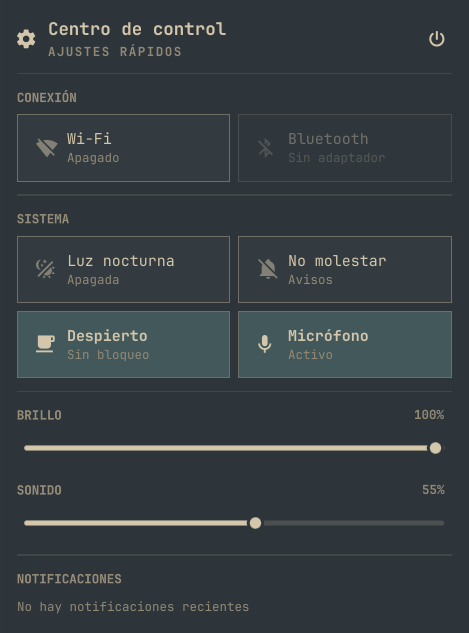

# Centro de control

Quick settings, recent notifications, and session actions in a panel anchored
to the Omarchy bar. The interface is in Spanish.



## What it does

- **Bar:** a cog button. Click it to open or close the panel.
- **Conexión:** Wi-Fi and Bluetooth tiles.
- **Sistema:** night light, do not disturb, stay awake, and the microphone.
- **Sliders:** display brightness and output volume.
- **Notifications:** recent shell history, rendered as plain text. Clearing it
  is a separate action. Notification buttons are never run.
- **Session:** the power button at the top right opens lock, suspend,
  hibernate (only when the machine can hibernate), log out, reboot, and shut
  down. Suspend is hidden when Omarchy has suspend turned off.

## Keyboard

| Key | Action |
|---|---|
| `j` / `k` or arrows | move |
| `h` / `l` | change column |
| `Enter` / `Space` | activate the tile, slider, or session row |
| `Escape` | close the session menu, or the panel |
| `x` or `Delete` | clear notification history when that row is selected |

## Install

```sh
omarchy plugin add https://github.com/joseluiss2003/joseluis.control-center.git --enable --yes
```

Requires Omarchy 4 (Quattro). Wi-Fi, Bluetooth, brightness, night light, idle,
audio, and the session helpers are the ones Omarchy already ships. No extra
packages and no network access.

To place it in a specific bar section:

```sh
omarchy plugin enable joseluis.control-center right
```

## Remove

```sh
omarchy plugin remove joseluis.control-center --yes
```

Removing the plugin leaves the shell's notification history in place. That
history is not owned by this plugin.

## Optional keybinding

This plugin does not edit Hyprland or `shell.json`. To open the panel from
the keyboard, add a binding yourself in `~/.config/hypr/bindings.lua`:

```lua
o.bind("SUPER + CTRL + Y", "Centro de control", { panel = "joseluis.control-center" })
```

Pick a shortcut that is free on your machine. `SUPER + CTRL + Y` is only an
example.

## IPC

```sh
omarchy-shell shell summon joseluis.control-center
omarchy-shell shell hide joseluis.control-center
```

## How it works

`BarWidget.qml` is the bar button. `ControlCenter.qml` is the panel.
`State.js` caps notification text and returns one fixed argument list per
session action. Lock, log out, reboot, and shut down call the Omarchy system
helpers. Suspend and hibernate call `systemctl` with those two verbs only.

## License

[MIT](LICENSE)
